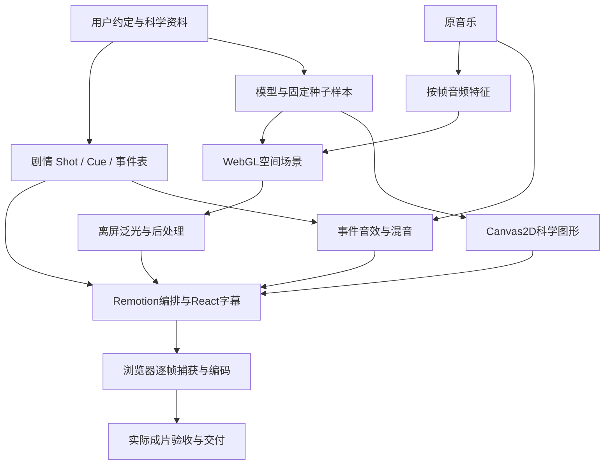

# 架构与职责

## 数据流

## 编排层

Remotion Composition声明fps、分辨率、帧数和输入参数；`useCurrentFrame()`给出帧号。React负责精确中文、标题、字幕、来源提示和安全区。音频放在统一时间轴，不能每切一页就重新开始。

编排层按绝对时间找场景，以局部时间驱动视觉；组合ID、集数、片长由本次项目配置决定。不要把注册过的测试组合误当作正式交付入口。

Shot含start/end/kind/kicker/title/dialogue/note/source；Cue含from/to/role/text。新工程可以改schema，但应保证时段无空洞或意外重叠，声音和字幕能关联具体事件。

## 模型层

模型独立输出概率、样本、曲线和结构。图形仅映射为位置、颜色、长度与密度，不在绘图函数里为美观改变物理参数。独立检验概率守恒、单位、样本总量与交叉公式。教学源谱、探测响应、真实数据和完整实验拟合必须区别。

## 图形层

WebGL处理大量粒子、线、透视、重组、表面与光传播；Canvas2D处理坐标轴、波形、误差条、公式与可审查图示。不是每一张图都需要3D引擎。

旧绘图函数分离背景后可以复用：案例drawEpisode支持layerOnly，避免重复盖住全局空间背景。重新排版时同时检查图内小标题、轴标签与外部标题。

## 确定性动画

时间t=f/fps；建议使用半开区间[start,end)，local=t-start。动画是帧号、参数、固定种子的函数，任意帧可以独立重建。不要用Date.now、未固定随机数、requestAnimationFrame累计位移或worker执行顺序生成画面。真实时间仅用于进度日志。

粒子可由解析轨迹、起终点插值和闭式衰减直接计算。必须积分的物理先缓存固定时间步，再定义帧采样，不能假定渲染总从0帧顺序执行。

## WebGL实现细节

案例原生WebGL缓冲区将编号、采样值与组别打包，分组表现背景、点阵、传感器、闪烁光、直线传播、透明表面、线段与短暂粒子标题。使用look-at和透视矩阵产生前后景视差。

球面点用Fibonacci近似均匀分布，是示意而非真实工程布局。透明球体用解析射线相交、边缘光和高光近似，不是经过标定的真实光学追迹。

场景绘入全尺寸离屏纹理，降采样后水平/垂直模糊，再叠回原图；色调映射、暗角和局部亮度保护阅读。点精灵可用gl_PointCoord绘发光核和环；线段片元应走独立分支，不能依赖点精灵坐标。捕获前保证绘制完成，卸载时释放GPU资源。

循环转球、统一正弦漂浮或满屏噪点仍会像模板。空间感来自远近比例、侧向视差、遮挡、进入前景及镜头与对象的相对变化。

## 语义时间优于特效时间

案例sceneClock为复用32秒样片映射了固定视觉时钟。这是题材特定折中，不是通用架构。新作宜传interactionTime、photonAge、gatherProgress、cameraPose等语义状态，避免把所有场景绑到同一个片段。

音频特征用全片帧号，模型可用局部过程时间；音乐、剧情与视觉时间之间的换算要明确。切片渲染时也不能把全片音乐误从切片0秒开始。

## 生成媒体的接口

人物表演、实景和复杂质感可以用实拍或生成素材，作为普通时间媒体接入。文字和精确图表仍可程序叠加。Hypit可协助导演与媒体生成编排，但本案例最终渲染是Remotion/WebGL，不是调用一个Hypit模板或文生视频模型自动得到。

## 通用机制代码

assets/animation-core提供SceneLayer.tsx与deterministic-motion.ts。前者从当前Composition读取画幅与fps，后者以项目传入的transition起终时刻计算确定性形变。没有预置作品标题、题材、集数或固定卡点。例子只演示散点到球面的几何变化，实际科学模型与画面需按主题另行设计；它不代表完整的视觉效果库。

## 可运行接口与离线三维

新工程使用assets/project-template/shared/project.mjs统一规范化配置和帧上下文，模型与图形分离。参见[脚手架](scaffold.md)。Blender按镜头生成时间媒体，接受相同事件表并明确帧映射，作为Remotion的一层合成；参见[Blender](blender.md)。基础运行不依赖Blender。
